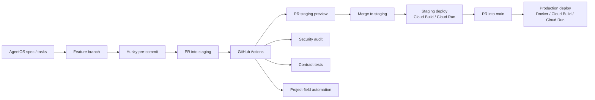

# How I build at AMI

**Employer:** KMC MAG Solutions (client: AMI)  
**Visibility:** Process note for portfolio review. No repository links, credentials, or internal URLs.

This is the engineering workflow I learned and used while helping build the AMI portal and its warehouse query layer from early product work into a staged, production deploy path. I use AI pair programming with Cursor and Claude as part of this loop, not as a substitute for review.

---

## Problem

A client-facing analytics portal and a BigQuery query service cannot be shipped from a laptop-only workflow. Changes need a repeatable path: specify the work, implement it on a branch, prove it, preview it, then promote to staging and production without mixing secrets into source.

## How I work

**Specify, then build.** Product intent lives in AgentOS: a mission, roadmap, and tech-stack note, plus dated feature specs. A typical spec folder has a `spec`, a `tasks` breakdown, and often an `orchestration.yml` that sequences implementation. I treat that as the contract for a change before opening a branch.

**GitHub flow.** Work happens on feature branches. Pull requests go to `staging` first, then to `main` for production. I do not push directly to production branches.

**Guards on the way in.** Husky pre-commit hooks catch basic local issues before a push. GitHub Actions on the PR and on `staging` / `main` run:

- staging previews for a PR, so reviewers can see the AMI portal change without merging to production
- a security audit workflow
- contract tests (especially on the query layer, where widget and dataset contracts must stay in parity)
- project-field automation so issues and PRs stay labelled in the delivery board

**AI in the loop.** I pair with Cursor (rules and skills in the repo) and Claude (including worktrees for isolated changes). For the AMI portal chat experience, the team integrated LangChain and traces work in LangSmith (confirmed). I still read diffs, run tests, and go through PR review.

**Ship with containers.** Backend deploys use Docker images built by Cloud Build and served on Cloud Run. Secrets belong in a secret manager or the host environment, never in git. Frontend hosting is separate from the Cloud Run API.

## Stack

GitHub (branches, PRs, Actions), Husky, AgentOS specs, Cursor and Claude, LangChain with LangSmith for chat, Docker, Cloud Build, and Cloud Run — around TypeScript/React on the AMI portal and Node.js plus BigQuery on the query layer.

## Impact

This workflow is how portal and query-layer changes reach clients: specified, reviewed, previewed on staging, then promoted. It keeps AI-assisted work inside the same branch-and-PR discipline as any other change.

This note contains no source, repository links, credentials, hostnames, or project identifiers.
