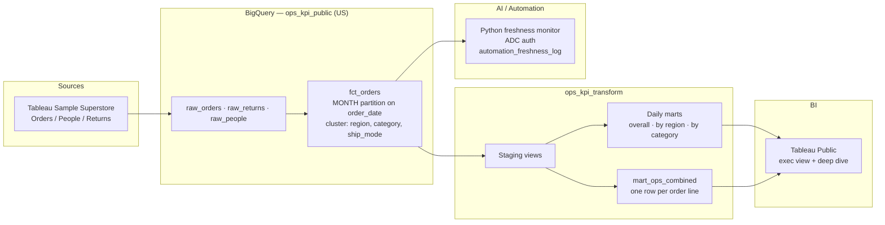

# Ops KPI cost & quality — flagship

> Public portfolio project: **sample retail/ops data -> BigQuery -> transform -> Tableau Public -> freshness monitor**.  
> Built for strangers to grasp stack + business value in under 5 minutes.  
> **Status:** Warehouse, transform, and freshness monitor are in place. Public GitHub repo and GitHub Pages site are live. Tableau Public workbook is coming soon. Redacted walkthroughs of the reporting portal and the monitoring tool are on the live site.

## Problem

Operators and analysts often live in disconnected exports: yesterday’s CSV, a fragile spreadsheet, and a dashboard that refreshes “sometime.” Cost and quality questions — *Are we fulfilling on time? Is return rate eating margin? Did last night’s load even land?* — take too long to answer and are easy to get wrong.

This flagship shows a **one-person data team** pattern: warehouse the facts once, model trustworthy daily KPIs, put an executive story on Tableau Public, and wire a small automation that proves the pipeline is alive.

## Architecture



## Stack

| Layer | Choice | Notes / links |
|---|---|---|
| Source | Tableau Sample Superstore (Orders, People, Returns) | Fictitious retail sample shipped with Tableau. **No formal open-data license** in Tableau’s primary docs — treat as sample/demo data, not redistributable open data. Docs: Tableau Public sample data and Tableau “find good datasets” help. Prior thelook ecommerce source was superseded. |
| Warehouse | Google BigQuery dataset `ops_kpi_public` (US) | Raw: `raw_orders` (10,194 rows), `raw_returns` (296), `raw_people` (4). Fact: `fct_orders` (10,194 rows, same grain as `raw_orders`: one row per order line, key `row_id`). Full GCP project ID omitted from this public README. |
| Raw modeling | Monthly partition + cluster | `fct_orders` is partitioned by month on `order_date` and clustered by `region`, `category`, `ship_mode`. |
| Cost note | Representative Q1 query | Same ops-KPI query (Q1 window on `order_date`, with returns): **646,869 bytes** scanned on unpartitioned `raw_orders` vs **27,820 bytes** on `fct_orders` (~95.7% fewer bytes processed). On-demand billing still applied the 10 MB minimum to both jobs in this sandbox; partition/cluster matter more as tables grow past that minimum. |
| Transform | BigQuery SQL views + partitioned mart tables in `ops_kpi_transform` (no Tableau Prep; thin dbt deferred) | Staging views: `stg_order_lines`, `stg_returns`, `stg_region_managers`. Three daily marts (partitioned on `order_date`): `mart_daily_ops_kpis`, `mart_daily_ops_by_region`, `mart_daily_ops_by_category`. Plus `mart_ops_combined`: one row per order line, 10,194 rows, 21 Orders fields + `regional_manager` + returned flags. Metric dictionary: `order_count`, `line_count`, `sales`, `profit`, `margin_pct`, `avg_ship_days`, `returned_order_count`, `return_rate` (ratios stored 0–1). |
| BI | Tableau Public | Profile: https://public.tableau.com/app/profile/russel.king.enriquez7984/vizzes · workbook `<TABLEAU_PUBLIC_WORKBOOK_URL>` (coming soon — none published yet). |
| AI / automation | Python freshness monitor, Application Default Credentials only (no secrets in repo) | Checks `raw_orders`, `raw_people`, `raw_returns`, and `fct_orders` against a 24h SLA and appends `ok` / `stale` / `error` rows to `ops_kpi_public.automation_freshness_log`. Transient BigQuery errors retry with backoff. Live run on **2026-11-06: 4/4 ok**. Script lives with the automation package (`freshness_monitor.py`); dry-run needs no credentials. |
| Packaging | This README + walkthroughs + company-work case studies | [Monitoring walkthrough](https://gnik014.github.io/portfolio-russel-enriquez/assets/video/monitoring-demo.mp4) · [Reporting portal walkthrough](https://gnik014.github.io/portfolio-russel-enriquez/assets/video/portal-demo.mp4) · case studies in `../company-work/` |

## Outcome

- A stranger can follow warehouse -> transform -> dashboard -> freshness log from this README (Tableau workbook coming soon).
- Partitioning and clustering cut a representative Q1 query from **646,869** to **27,820** bytes scanned.
- Daily marts and `mart_ops_combined` give BI named metrics (orders, sales, profit, margin, ship days, returns) without guessing columns.
- The 2026-11-06 freshness run logged **4/4 ok** for the four watched tables in `automation_freshness_log`.

**Business value:** fewer manual pulls, clearer daily ops KPIs, and a portable pattern already used in professional BigQuery + Tableau + automation work (see `EXPERIENCE.md` and `../company-work/`).

## Related work

| Area | Status |
|---|---|
| Database | `ops_kpi_public` loaded and documented (row counts, partition/cluster, cost note). Project ID kept off this public page. |
| Transform | Staging + three daily marts + `mart_ops_combined` in `ops_kpi_transform`; metric dictionary available for BI. |
| BI | Tableau Public workbook URL coming soon. |
| AI Automation | Freshness monitor live-logged 2026-11-06 (4/4 ok). |
| Case studies | `../company-work/` |

## Repo layout

```text
ops-kpi-public/          https://github.com/Gnik014/portfolio-russel-enriquez
  README.md              <- this file
  sql/ or dbt/           transform
  scripts/               load + freshness monitor
  docs/                  cost notes, metric dictionary
```

**GitHub URL:** https://github.com/Gnik014/portfolio-russel-enriquez  
**Live site (GitHub Pages):** https://gnik014.github.io/portfolio-russel-enriquez/

## Safety

Sample/demo Superstore data only for this flagship — not a formal open license. Never commit service-account keys, the full GCP project ID in casual outreach if avoidable, client extracts, or gaming/prod credentials.
